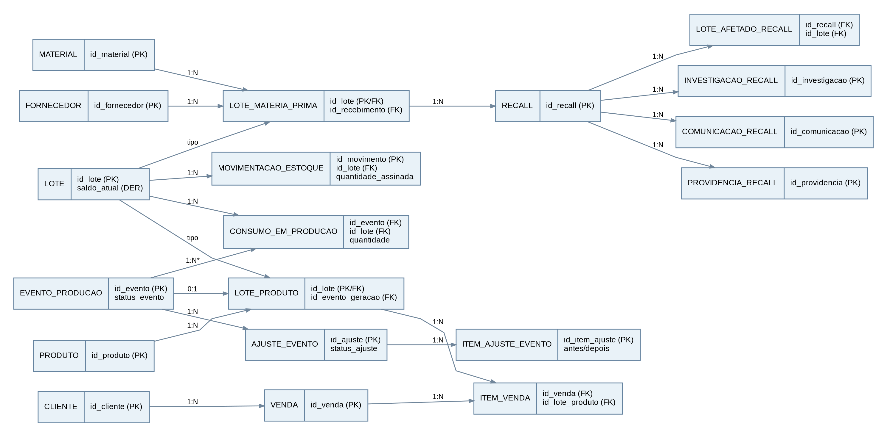
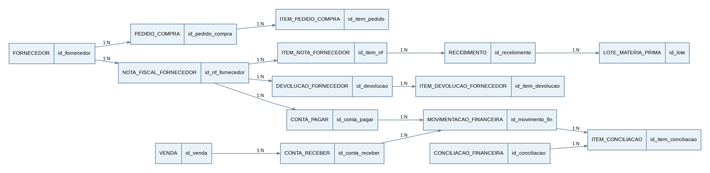

# Diagrama Entidade-Relacionamento (DER)

Modelo de dados do ERP de rastreabilidade por lote da Metalúrgica Vértice (empresa fictícia).
A cadeia central é LOTE → EVENTO_PRODUCAO → CONSUMO_EM_PRODUCAO. O DER está dividido em duas visões complementares.

Versão online: [DER – Projeto ERP Metalúrgica Vértice](https://claude.ai/artifact/9SdS64T6Kzqf2UQNc1qFuW)

## Visão 1: núcleo da rastreabilidade, produção, estoque e qualidade

A participação EVENTO_PRODUCAO → LOTE_PRODUTO é (0,1) enquanto o evento está aberto e (1,1) após o encerramento válido. O consumo é obrigatório para concluir o evento.

## Visão 2: compras, recebimentos e financeiro

A ligação ITEM_PEDIDO_COMPRA ↔ ITEM_NOTA_FORNECEDOR pode ser opcional quando houver recebimento excepcional sem pedido; o vínculo é representado pelo campo id_item_pedido em ITEM_NOTA_FORNECEDOR.
